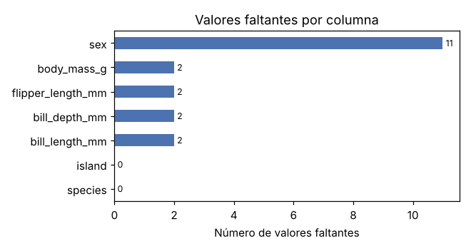
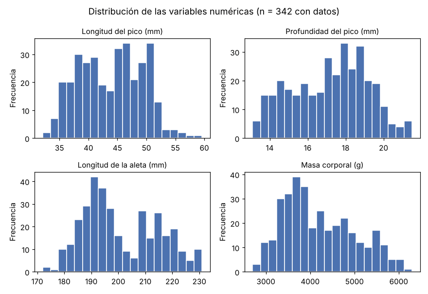

# Grupo 1 – Análisis exploratorio del dataset *Palmer Penguins*

Proyecto conjunto del curso **Nuevas herramientas digitales y entornos de computación para la investigación en Ciencias e Ingeniería** (Universidad de Jaén, noviembre de 2026), módulo 2: *Buenas prácticas en ciencia computacional con Python*.

## Participantes

| Nombre | Usuario de GitHub | Parte del análisis |
|---|---|---|
| Yifan Ma | [@evanma0211](https://github.com/evanma0211) | Resumen general del dataset |
| _(pendiente)_ | | |
| _(pendiente)_ | | |
| _(pendiente)_ | | |
| _(pendiente)_ | | |
| _(pendiente)_ | | |

## Dataset

**Palmer Penguins** (Horst, Hill & Gorman, 2020) recoge medidas de 344 pingüinos de tres especies (*Adelie*, *Chinstrap* y *Gentoo*) observados en tres islas del archipiélago Palmer (Antártida) entre 2007 y 2009.

- Archivo: [`data/penguins.csv`](data/penguins.csv) (344 filas, 7 columnas)
- Fuente: Gorman, K. B., Williams, T. D., & Fraser, W. R. (2014). *PLoS ONE*, 9(3), e90081. https://doi.org/10.1371/journal.pone.0090081 — copia tomada de https://github.com/mwaskom/seaborn-data
- Licencia: CC0

| Columna | Descripción |
|---|---|
| `species` | Especie (Adelie, Chinstrap, Gentoo) |
| `island` | Isla (Biscoe, Dream, Torgersen) |
| `bill_length_mm` | Longitud del pico (mm) |
| `bill_depth_mm` | Profundidad del pico (mm) |
| `flipper_length_mm` | Longitud de la aleta (mm) |
| `body_mass_g` | Masa corporal (g) |
| `sex` | Sexo (MALE, FEMALE) |

## Estructura del repositorio

```
data/       datos originales (no se modifican)
analisis/   un script de Python por cada parte del análisis
figuras/    figuras generadas por los scripts
```

## Cómo ejecutar el análisis

```bash
pip install -r requirements.txt
python analisis/01_resumen_general.py
```

Cada script lee `data/penguins.csv`, imprime sus resultados y guarda sus figuras en `figuras/`.

## Cómo contribuir

Ver [`CONTRIBUTING.md`](CONTRIBUTING.md): cada participante hace un *fork*, crea una rama, añade su parte del análisis y envía un *pull request*, que debe ser aprobado por al menos otra persona del grupo antes de mezclarse.

## Resultados

_Cada participante añade aquí un resumen breve de su parte._
### Parte 1 – Resumen general (Yifan Ma)

Script: [`analisis/01_resumen_general.py`](analisis/01_resumen_general.py)

- El dataset tiene **344 filas y 7 columnas** (3 categóricas y 4 numéricas).
- Faltan **2 valores** en cada variable numérica y **11** en `sex`.
- Valores más frecuentes: especie **Adelie** (152), isla **Biscoe** (168) y sexo **MALE** (168 de 333).
- Medias: pico 43,9 mm de longitud y 17,2 mm de profundidad; aleta 200,9 mm; masa corporal 4.202 g (mín. 2.700 g, máx. 6.300 g).
- Las distribuciones de la aleta y de la masa corporal parecen bimodales, lo que sugiere diferencias entre especies (ver partes 3–5).



